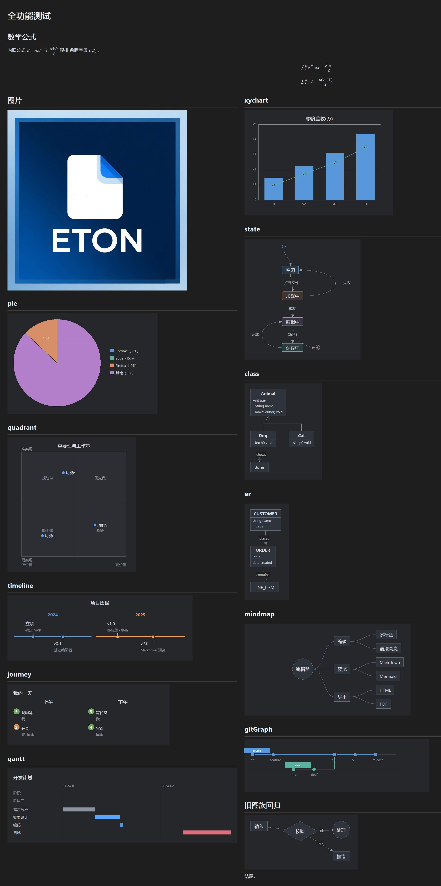

# ETON

[English](README.md) | [简体中文](README.zh-CN.md)

A Notepad++-style text editor for Windows built with the **native Win32 C API** (no MFC / Qt / .NET / Electron).

The whole program is only 2 MB.

- Builds directly with Visual Studio Build Tools (MSVC) into a single `eton.exe`
- Statically linked CRT (`/MT`) + Scintilla + Lexilla — the binary only depends on system DLLs and can be copied to any Windows machine and run
- Embeds a Common Controls v6 manifest and automatically picks up the system theme (including a dark title bar/controls)

&nbsp;&nbsp;

---

## Features

| Category | Description |
| --- | --- |
| Multi-tab | Custom-drawn tab bar; edit multiple files at once |
| UI language | Simplified Chinese / English UI; follows the system UI language on first launch |
| Syntax highlighting | 10 languages: C / C++ / C# / Java / JavaScript / Python / XML(HTML) / JSON / SQL / Markdown; auto-detected by extension and switchable from the language menu; code-folding margin shown for lexer languages |
| Markdown preview | F12 toggles edit ↔ rendered view in the current tab; Shift+F12 side-by-side split (editor left, preview right, two-way synced scrolling); **live rendering as you type** (in split view the preview re-renders ~0.4s after you stop typing, keeping the scroll position; full preview becomes a Typora-style single surface after enabling **View → Edit in Preview** (off by default) — **click any block to flip just that block into editable source while everything else stays rendered**, arrow up/down walks across blocks, Enter at a block's end appends a new paragraph, Backspace at a block's start merges into the previous one, the document re-renders around you ~0.3s after you pause and the edit box repositions itself, each commit is a single undo step, click the empty area past the last block to append a paragraph); **13 Mermaid diagram families rendered natively** (flowchart / sequence / state / class / ER / pie / quadrant / timeline / journey / gantt / xychart / mindmap / gitGraph), unrecognized families fall back to source view with a hint; **math formulas** (`$..$` inline and `$$..$$` block, with `\(..\)`/`\[..\]` delimiters normalized automatically — a LaTeX subset: fractions, roots, sub/superscripts, Greek letters, sums/integrals, `cases`/`matrix` family/`aligned` environments with sized delimiters, typeset in Cambria Math); **footnotes** (`[^label]` refs render as link-colored [N], definitions collected into a rule + numbered list at the end, unreferenced ones omitted); **code blocks syntax-highlighted** per fence language (C/C++/C#/Java/JS/TS/Go/Rust/Python/JSON/XML/SQL/Bash — keywords, strings, comments, numbers, preprocessor); **embedded images** (SVG rasterized natively via bundled nanosvg — GitHub-style badges/shields render); export to **HTML** and **PDF** (paginated via the print dialog); colors follow the light/dark theme, font size follows editor zoom |
| Multi-encoding | ANSI (system code page) / UTF-8 / UTF-8 BOM / UTF-16 LE / UTF-16 BE; BOM auto-detected on open; **click the encoding in the status bar to switch directly**; warns about potential mojibake when saving ANSI content that cannot be represented |
| Line endings | CRLF / LF / CR with one-click "Convert to…"; **click the EOL in the status bar to switch directly**; new documents and undetectable files default to Unix (LF); existing files keep their detected ending |
| Language switch | **Click the language name in the status bar** to switch the current document's syntax highlighting |
| JSON tools | Tools menu: JSON format / minify (`Ctrl+Shift+F` / `Ctrl+Shift+M`); applies to the selection when there is one; indentation and EOL follow document settings; on parse failure, reports line/column and jumps to the offending character |
| Developer tools | Tools menu: Base64 / URL / Unicode (`\uXXXX`) encode & decode (replaces the selection or whole document, undoable, jumps to invalid characters on decode failure); MD5 / SHA-1 / SHA-256 / SHA-512 hash dialog (all four at once, uppercase toggle, per-row copy); insert UUID v4; Unix timestamp ↔ date-time conversion; insert date/time |
| Explorer integration (Store) | Microsoft Store (MSIX) builds get "Edit with Eton" on the right-click menu of all supported file types (`.md`/`.txt`/`.json` etc., matching the file type association list) natively: the package manifest declares `desktop4:FileExplorerContextMenus` backed by `etonctx.dll` (IExplorerCommand), so Windows registers it — update-proof, no prompts, shown in the Win11 top-level menu, and the package opts `HKCU\...\.md\ShellNew` out of registry virtualization so the app registers a **"New → Markdown file"** entry (restricted capability, Win10 20348+). Portable/zip builds ship no Explorer integration |
| Find / Replace / Go to | Non-modal find dialog; case sensitivity, whole word, regular expressions, up/down, wrap-around search; all matches highlighted; Replace supports single and replace-all (replace-all is a single undo step); Go to line. **Extended mode** (Notepad++-style): `\n` `\r` `\t` `\0`/`\b` (NUL) `\f` `\v` `\xHH` `\dDDD` `\\` escapes are interpreted in both the search and replacement text (mutually exclusive with regex mode; replacement can insert real line breaks/tabs/NUL bytes) |
| Bookmarks | Toggle a bookmark on the current line, jump between bookmarks, whole-line highlight |
| Recent files | Recently opened files tracked automatically; reopen with one click from the menu |
| Line-number gutter | Scintilla's built-in line-number margin, synced live while scrolling; current line highlighted |
| Zoom | Zoom in / out / reset; ratio shown in the status bar |
| Word wrap | Toggle soft wrap from the View menu |
| Status bar | Live characters / line / column / encoding / language / EOL / zoom; encoding, language and EOL are click-to-switch |
| Themes | Light and dark color schemes; title bar, menus (dropdowns and context menus), dialogs, tab bar, editor, scrollbars and status bar all follow |
| Persistent settings | Theme / word wrap / line numbers / font size / UI language saved on exit and restored on launch |
| Command line | `eton.exe file1 file2 …` opens multiple files directly |
| Drag & drop | Drop files from Explorer onto the window, several at once; already-open files switch to their tab; directories are ignored |
| Session restore | Remembers all tabs and the active tab in original order; deleted files are skipped automatically |
| Window position | Window position/size and maximized state are remembered on exit and restored on next launch; centered on first run |
| Drafts & backups | Untitled documents are saved as drafts every 10 seconds and recoverable after a crash; unsaved changes of saved files are also backed up every 10 seconds — after an abnormal exit, reopening the file asks whether to restore; backups are cleared on tab close or save |
| External change detection | Detects whether the file was modified by another program before saving and warns about overwrite risk; detects on-disk changes when the window regains focus and asks whether to reload |
| Large files | Streamed load/save up to 1 GB with a cancellable progress dialog; files over 1 GB are rejected with a message; whole-document in-memory operations such as JSON formatting are disabled above 100 MB |

---

## Usage

- **Top layout**: the tab strip is merged into the title bar (Win11 Notepad style) — row 1 = app icon (click for the full menu) / tabs / `+` new / min-max-close at the far right; drag empty areas to move the window, double-click to maximize. Row 2 = the command strip: File / Tools / View menu buttons + frequently used icon buttons.
- **Status-bar click-to-switch**: click the encoding, language or EOL cell to pop up a menu (current item checked); changes apply immediately.
- **Markdown preview**: `F12` edit ↔ rendered view, `Shift+F12` side-by-side split, `Esc` back to editing; live rendering in split view; the Typora-style block editing of the full preview is enabled via View → Edit in Preview (off by default).
- **Export HTML / PDF**: File menu → Export. HTML is a self-contained single file (embeds mermaid.js with a MathJax CDN fallback); PDF goes through the system print dialog with pagination.
- **Context menus**: editor right-click = cut/copy/paste/select all/open containing folder; tab right-click = close / close others / close all; middle-click closes a tab, double-clicking empty tab-strip space creates one.
- **UI language**: Help → UI language, effective immediately.
- **Keyboard shortcuts**:

| Action | Shortcut |
| --- | --- |
| New / Open / Save / Close tab | `Ctrl+N` / `Ctrl+O` / `Ctrl+S` / `Ctrl+W` |
| Find / Replace / Go to line | `Ctrl+F` / `Ctrl+H` / `Ctrl+G` |
| Find next / previous | `F3` / `Shift+F3` |
| JSON format / minify | `Ctrl+Shift+F` / `Ctrl+Shift+M` |
| Base64 encode / decode | `Ctrl+Alt+B` / `Ctrl+Alt+Shift+B` |
| Zoom in / out / reset | `Ctrl+=` / `Ctrl+-` / `Ctrl+0` |
| Bookmark toggle / next / previous | `Ctrl+F2` / `F2` / `Shift+F2` |
| Markdown preview / split | `F12` / `Shift+F12` |
| Switch tabs | `Ctrl+Tab` / `Ctrl+Shift+Tab` (or `Ctrl+PgDn` / `Ctrl+PgUp`) |

---

## Known limitations

- Markdown preview: Mermaid covers 13 common families; niche families (C4, Sankey, requirement diagrams, etc.) fall back to source view; math is a common LaTeX subset (unknown environments render as plain content).
- Not implemented: column selection, macros, plugins, printing.

---

## License

This project is sample code — free to learn from, modify and redistribute. Scintilla and Lexilla follow their respective License.txt (HPND license); MD4C (`deps/md4c/`) is MIT (see `deps/md4c/LICENSE.md`); the embedded mermaid.min.js (`deps/mermaid/`) is MIT (Mermaid © 2014-2024 Knut Sveidqvist); nanosvg (`deps/nanosvg/`, © 2013-14 Mikko Mononen) is Zlib.
