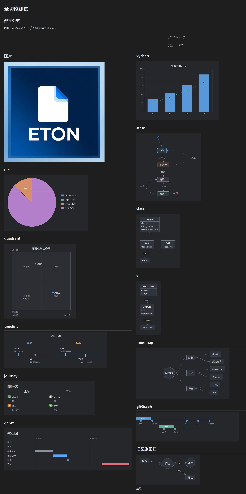

# ETON

[English](README.md) | 简体中文

一个用 **原生 Win32 C API**（不依赖 MFC / Qt / .NET / Electron）实现的、类 Notepad++ 的 Windows 文本编辑器。

软件大小只有2M。

- 源码可直接用 Visual Studio 生成工具（MSVC）编译为单个 `eton.exe`
- 静态链接运行库（`/MT`）+ Scintilla + Lexilla，编译产物仅依赖系统 DLL，可直接拷贝到其他 Windows 机器运行
- 内嵌 Common Controls v6 清单，自动获得系统主题（含暗色标题栏/控件）

&nbsp;&nbsp;

---

## 功能特性

| 类别 | 说明 |
| --- | --- |
| 多标签 | 自定义标签栏，可同时编辑多个文件 |
| 界面语言 | 简体中文 / English 双语界面，未选择过时首次启动跟随系统 UI 语言 |
| 语法高亮 | 10 种语言：C / C++ / C# / Java / JavaScript / Python / XML(HTML) / JSON / SQL / Markdown；按扩展名自动识别，也可在语言菜单手动切换；语法语言下显示代码折叠边距|
| Markdown 预览 | F12 在当前标签内切换 编辑 ↔ 渲染视图，Shift+F12 并排分屏（左编辑右预览，双向同步滚动）；**输入即渲染**（分屏下打字停顿约 0.4s 预览自动重渲染且保持滚动位置；全窗预览经 **视图 → 预览内编辑** 开启后为类 Typora 单面编辑——**单击任意块就地将该块转为源码编辑，其余块保持渲染**，↑/↓ 跨块移动、块末 Enter 新建段落、块首 Backspace 并入上一块，打字停顿约 0.3s 周围实时重渲染且编辑框不跳，每次提交为单步可撤销操作，尾部空白处单击新建段落；默认关闭，关闭时全窗预览为纯查看）；**Mermaid 13 个图族原生绘制**（流程图/时序图/状态图/类图/ER 图/饼图/四象限/时间线/旅程图/甘特图/xychart/思维导图/gitGraph），未识别图族回退为源码显示并提示；**数学公式**（`$..$` 行内与 `$$..$$` 块级，`\(..\)`/`\[..\]` 定界符自动归一；分式/根号/上下标/希腊字母/求和积分等 LaTeX 子集，`cases`/`matrix` 族/`aligned` 环境带自适应大分隔符，Cambria Math 字体排版）；**脚注**（`[^label]` 引用渲染为链接色 [N]，定义收集到文末的"分隔线+编号列表"区，未引用的定义不显示）；**代码块按围栏语言语法高亮**（C/C++/C#/Java/JS/TS/Go/Rust/Python/JSON/XML/SQL/Bash——关键字、字符串、注释、数字、预处理）；**图片内嵌**（SVG 经内置 nanosvg 原生光栅化，GitHub 风格徽章/shields 可直接渲染）；导出 **HTML**与 **PDF**（打印对话框分页渲染）；配色跟随亮/暗主题，字号跟随编辑器缩放 |
| 多编码 | ANSI(系统代码页) / UTF-8 / UTF-8 BOM / UTF-16 LE / UTF-16 BE，打开时自动探测 BOM；**状态栏点击编码可直接切换**；另存 ANSI 时若内容含无法表示的字符会提示乱码风险 |
| 行尾转换 | CRLF / LF / CR，可一键"转换为…"；**状态栏点击行尾可直接切换**；新文档及探测不到行尾的文件默认 Unix (LF)，打开已有文件时按内容自动探测并保持 |
| 语言切换 | **状态栏点击语言名可直接切换**当前文档的语法高亮语言 |
| JSON 工具 | 工具菜单：JSON 格式化/压缩（`Ctrl+Shift+F` / `Ctrl+Shift+M`）；有选区时只处理选区，缩进与行尾跟随文档设置；解析失败提示出错行列并定位到出错字符 |
| 开发者工具 | 工具菜单：Base64 / URL / Unicode(\uXXXX) 编解码（直接替换选区或全文，可撤销，解码失败定位非法字符）；MD5 / SHA-1 / SHA-256 / SHA-512 哈希对话框（一次显示四种结果、可切大写、逐行复制）；插入 UUID v4；Unix 时间戳 ↔ 日期时间双向转换；插入日期/时间 |
| 资源管理器集成（商店版） | 微软商店（MSIX）版原生获得全部支持类型（.md/.markdown/.txt 等，与文件类型关联列表一致）右键"用 Eton 编辑"：包清单经 `etonctx.dll`（IExplorerCommand）声明 `desktop4:FileExplorerContextMenus`，由 Windows 统一注册——升级不断、无确认框、直接显示在 Win11 一级菜单；包清单把 `HKCU\...\.md\ShellNew` 排除出注册表虚拟化，应用启动即注册**"新建 → Markdown 文件"**（受限能力，Win10 20348+ 生效）；便携版不含资源管理器集成 |
| 查找 / 替换 / 转到 | 非模态查找对话框；支持区分大小写、全词匹配、正则表达式、向上/向下、循环查找；命中项全部高亮显示；`替换` 支持单个替换与全部替换（全部替换为单步撤销）；`转到行`。**扩展模式**（Notepad++ 风格）：查找与替换文本均可解释 `\n` `\r` `\t` `\0`/`\b`（NUL）`\f` `\v` `\xHH` `\dDDD` `\\` 转义（与正则模式互斥；替换可插入真实换行/制表/NUL 字节） |
| 书签 | 切换当前行书签、在书签间跳转，书签行整行高亮 |
| 最近文件 | 自动记录最近打开的文件，菜单可一键重新打开 |
| 行号槽 | Scintilla 内建行号 margin，随编辑区滚动实时同步；当前行自动高亮 |
| 缩放 | 放大 / 缩小 / 复位，状态栏显示缩放比例 |
| 自动换行 | 视图菜单可切换软换行 |
| 状态栏 | 实时显示 字符数 / 行 / 列 / 编码 / 语言 / 行尾 / 缩放，编码、语言、行尾支持点击切换 |
| 主题 | 亮色与暗色两套配色，标题栏、菜单（含下拉/右键弹窗）、对话框、标签栏、编辑区、滚动条、状态栏全部跟随 |
| 设置记忆 | 主题 / 自动换行 / 行号 / 字号 / 界面语言随退出保存、启动恢复 |
| 启动参数 | 可 `eton.exe 文件1 文件2 …` 直接打开多个文件 |
| 文件拖放 | 从资源管理器拖文件到窗口即可打开，支持一次拖入多个；已打开的文件切换到对应标签，目录自动忽略 |
| 会话恢复 | 按原顺序记住上次的全部标签及激活标签，下次启动自动恢复；已删除的文件自动跳过 |
| 窗口位置 | 退出时记住窗口位置/大小与最大化状态，下次启动原样恢复；首次运行居中显示 |
| 草稿与备份 | 未命名文档内容每 10 秒保存草稿，崩溃后可恢复；已保存文件的未保存修改也每 10 秒自动备份，异常退出后再次打开该文件时询问是否恢复；关闭标签或保存后备份自动清除 |
| 外部修改检测 | 保存前检测文件是否被其他程序修改并提示覆盖风险；切回窗口时检测磁盘变化并询问是否重新加载 |
| 大文件支持 | 流式加载/保存，可打开最高 1 GB 的文件，大文件加载/保存带进度框可取消；超过 1 GB 拒绝打开并提示；JSON 格式化等整篇内存操作对超过 100 MB 的文档禁用 |

---

## 使用

- **顶部布局**：标签条与标题栏合并（Win11 记事本风格）——第一行 = 应用图标（点击弹出完整菜单）/ 标签 / `+` 新建 / 最右最小化-最大化-关闭，空白处拖动窗口、双击最大化；第二行命令条 = 文件 / 工具 / 视图 菜单按钮 + 常用图标按钮。
- **状态栏点击切换**：编码、语言、行尾三格可直接点击弹出菜单切换（当前项勾选），立即生效。
- **Markdown 预览**：`F12` 编辑 ↔ 渲染，`Shift+F12` 并排分屏，`Esc` 切回编辑；分屏下输入即渲染；全窗预览的类 Typora 块编辑经 视图 → 预览内编辑 开启（默认关闭）。
- **导出 HTML / PDF**：文件菜单 → 导出。HTML 为自包含单文件（内嵌 mermaid.js 与 MathJax CDN 回退）；PDF 走系统打印对话框分页渲染。
- **右键菜单**：编辑区右键 = 剪切/复制/粘贴/全选/打开所在文件夹；标签右键 = 关闭/关闭其他/关闭全部；标签中键关闭、双击空白新建。
- **切换界面语言**：帮助 → 界面语言，即时生效。
- **快捷键**：

| 操作 | 快捷键 |
| --- | --- |
| 新建 / 打开 / 保存 / 关闭标签 | `Ctrl+N` / `Ctrl+O` / `Ctrl+S` / `Ctrl+W` |
| 查找 / 替换 / 转到行 | `Ctrl+F` / `Ctrl+H` / `Ctrl+G` |
| 查找下一个 / 上一个 | `F3` / `Shift+F3` |
| JSON 格式化 / 压缩 | `Ctrl+Shift+F` / `Ctrl+Shift+M` |
| Base64 编码 / 解码 | `Ctrl+Alt+B` / `Ctrl+Alt+Shift+B` |
| 缩放 放大 / 缩小 / 复位 | `Ctrl+=` / `Ctrl+-` / `Ctrl+0` |
| 书签 切换 / 下一个 / 上一个 | `Ctrl+F2` / `F2` / `Shift+F2` |
| Markdown 预览 / 分屏 | `F12` / `Shift+F12` |
| 切换标签 | `Ctrl+Tab` / `Ctrl+Shift+Tab`（或 `Ctrl+PgDn` / `Ctrl+PgUp`） |

---

## 已知限制

- Markdown 预览：Mermaid 已覆盖 13 个常用图族，其余小众图族（C4、桑基、需求图等）暂回退源码显示；数学公式为 LaTeX 常用子集（未知环境按普通内容渲染）。
- 未实现：列块选择、宏、插件体系、打印。

---

## 许可证

本项目为示例代码，可自由学习、修改、再分发。Scintilla 与 Lexilla 遵循其各自的 License.txt（HPND 许可证）；MD4C（`deps/md4c/`）遵循 MIT 许可（见 `deps/md4c/LICENSE.md`）；内嵌的 mermaid.min.js（`deps/mermaid/`）遵循 MIT 许可（Mermaid © 2014-2024 Knut Sveidqvist）；nanosvg（`deps/nanosvg/`，© 2013-14 Mikko Mononen）遵循 Zlib 许可。
